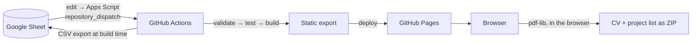

# Sebastian Grab – CV

[](https://github.com/sebastian-grab-smiit/sebastian-grab-smiit.github.io/actions/workflows/ci.yml)
[](https://github.com/sebastian-grab-smiit/sebastian-grab-smiit.github.io/actions/workflows/deploy.yml)

Bilingual (DE/EN) CV website at **[grab.smiit.de](https://grab.smiit.de)**, with a
one-click download of the CV and project list as PDF.

The content is maintained in a Google Sheet, so updating the CV never requires a code change:
editing the sheet triggers a rebuild, and the site is redeployed as static HTML to GitHub Pages.

## Architecture



- **Static by design.** Next.js renders both locales at build time (`output: "export"`). There
  is no server and no runtime API; the sheet is only read during the build.
- **Validated content.** Every sheet tab has a schema ([`lib/sheet/schema.ts`](lib/sheet/schema.ts)).
  The build checks the header row and every cell, and fails with the exact row and column of
  each problem. A broken sheet therefore never reaches production; the last good version stays
  online.
- **PDFs generated client-side** with `pdf-lib`. The generators are loaded only when the
  download is requested, so they add nothing to the initial page weight.

| Area      | Choice                                                                   |
| --------- | ------------------------------------------------------------------------ |
| Framework | Next.js 16 (App Router, static export), React 19, TypeScript             |
| Styling   | Tailwind CSS 4 with brand tokens in `app/globals.css`                    |
| Data      | Google Sheets CSV export, parsed with PapaParse, validated with Zod      |
| Motion    | Framer Motion, Lenis (both respect `prefers-reduced-motion`)             |
| Testing   | Vitest (unit), Playwright + axe-core (E2E, accessibility), Lighthouse CI |

## Getting started

Requires Node.js 24 (see `.nvmrc`).

```bash
npm install
cp .env.example .env   # fill in the sheet ID and tab GIDs
npm run check:sheet    # verify the sheet is reachable and valid
npm run dev            # http://localhost:3000/de/
```

### Scripts

| Command               | Purpose                                                  |
| --------------------- | -------------------------------------------------------- |
| `npm run dev`         | Development server                                       |
| `npm run build`       | Static export to `out/`                                  |
| `npm start`           | Serve `out/` locally, like GitHub Pages does             |
| `npm run check`       | Typecheck, lint, format check and unit tests (as in CI)  |
| `npm test`            | Unit tests                                               |
| `npm run test:e2e`    | E2E and accessibility tests against `out/` (build first) |
| `npm run check:sheet` | Validate the Google Sheet without building               |
| `npm run format`      | Format all files with Prettier                           |

## Configuration

| Variable                             | Description                                                                                             |
| ------------------------------------ | ------------------------------------------------------------------------------------------------------- |
| `NEXT_PUBLIC_GOOGLE_SHEET_ID`        | ID of the Google Sheet (from its URL)                                                                   |
| `NEXT_PUBLIC_GOOGLE_SHEET_<TAB>_GID` | `gid` of each tab: `PERSONAL`, `CERTIFICATES`, `LANGUAGES`, `ACADEMICS`, `SKILLS`, `RESUME`, `PROJECTS` |
| `NEXT_PUBLIC_CALENDLY_URL`           | Booking link used by "Talk to me" and `/meet`                                                           |

Locally these live in `.env`; in GitHub they are repository secrets. Dependabot pull requests
only receive [Dependabot secrets](https://docs.github.com/en/code-security/dependabot/working-with-dependabot/configuring-access-to-private-registries-for-dependabot#storing-credentials-for-dependabot-to-use),
so add the same values there for their builds to pass.

The sheet must be shared as "Anyone with the link can view". The expected columns of each tab
are defined in [`lib/sheet/schema.ts`](lib/sheet/schema.ts); dates use `YYYY-MM-DD`, lists
are separated by `;` and bullet points by `•`.

Static identity (name, domain, contact links, portrait) is configured in
[`site.config.ts`](site.config.ts).

## Deployment

| Trigger        | Result                                                                    |
| -------------- | ------------------------------------------------------------------------- |
| Pull request   | CI: checks, build, E2E, Lighthouse                                        |
| Push to `main` | CI, then deploy to GitHub Pages                                           |
| Sheet edited   | Apps Script → `repository_dispatch` → deploy                              |
| Manual         | "Run workflow" on the Deploy workflow, or "CV → Publish now" in the sheet |

The deploy job only runs after all CI jobs passed, and it deploys exactly the artifact that was tested.

### Automatic deploys from the sheet

[`scripts/google-apps-script/deploy-trigger.gs`](scripts/google-apps-script/deploy-trigger.gs)
debounces edits and dispatches one deploy once the sheet has been quiet for three minutes.

1. Create a [fine-grained personal access token](https://github.com/settings/personal-access-tokens/new)
   for this repository only, with the permission **Contents: Read and write**.
2. In the sheet, open **Extensions → Apps Script** and paste the script.
3. Under **Project Settings → Script properties**, add `GITHUB_TOKEN` with the token.
4. Run `setupTriggers` once from the editor and grant the permissions.

The sheet then has a **CV → Publish now** menu for immediate deploys. Renew the token before it
expires; failed dispatches show up under **Executions** in the Apps Script editor.

## Project structure

```
app/                  Routes: /[lang] (CV), / and /meet (redirects), sitemap, robots
components/page/      Page sections (hero, focus, skills, experience, projects, …)
components/ui/        Shared UI primitives
lib/sheet/            Sheet schema, parser and loader
lib/pdf/              Client-side PDF generation
lib/                  Formatting, SEO/JSON-LD, dictionary, brand palette
e2e/                  Playwright tests
scripts/              Sheet check, static server, Apps Script
site.config.ts        Name, domain and contact details
```

## Conventions

- Commits follow [Conventional Commits](https://www.conventionalcommits.org) (`feat:`, `fix:`,
  `chore:` …), enforced by a commit-msg hook.
- A pre-commit hook lints and formats staged files.
- Dependencies are kept current by Dependabot.
